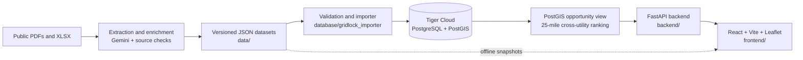

# GridLock

GridLock identifies nearby transmission projects from different electric utilities so teams can investigate possible coordination opportunities. It preserves source evidence, location quality, and schedule uncertainty throughout the pipeline.

## Architecture



### Runtime flow

1. Data scripts extract project candidates from public utility documents and preserve the evidence that supports every field.
2. Validated JSON is imported into Tiger Cloud PostgreSQL with PostGIS.
3. The PostGIS view ranks eligible cross-utility pairs using distance first and schedule overlap second.
4. FastAPI exposes projects, opportunities, and recommendations without recalculating the database ranking.
5. The React frontend displays the live API when it is available and uses committed snapshots only as an offline fallback.

See [docs/architecture.md](docs/architecture.md) for module responsibilities and constraints.

## Repository layout

```text
backend/                 FastAPI app, response models, database access, recommendations
frontend/                React/Vite application, Leaflet map, static fallback snapshots
database/                PostgreSQL/PostGIS migrations and validated JSON importer
data/                    Versioned project datasets and enrichment outputs
gemini_extraction/       Source-aware Gemini extraction workflow
location_enrichment/     OSM, Nominatim, and HIFLD enrichment tools
scripts/                 Repeatable validation, dataset-build, and audit commands
tests/                   Backend API and data-pipeline tests
docs/                    API, architecture, data audit, and validation documentation
postman/                 API request collection and local environment template
Challenge Docs/          Original challenge materials and public source documents
```

## Local development

### Backend

From the repository root, using Python 3.10 or newer:

```bash
python3 -m venv .venv
source .venv/bin/activate
python -m pip install -r requirements.txt
python -m uvicorn backend.main:app --reload --host 127.0.0.1 --port 8000
```

The API is available at `http://127.0.0.1:8000`, with OpenAPI documentation at `/docs`.

Set `DATABASE_URL` in the environment or copy `database/.env.example` to the ignored `database/.env`. The API never imports JSON or runs migrations at startup.

### Frontend

In a second terminal:

```bash
cd frontend
npm install
npm run dev
```

Vite serves the application at `http://127.0.0.1:5173` and proxies `/api` requests to the local backend. Set `VITE_API_URL` when connecting to a deployed API.

### Database importer

```bash
cd database
python -m pip install -e ".[dev]"
gridlock-import ../data/master_projects.json --dry-run
```

Apply migrations `001_initial_schema.sql` and `002_opportunity_timeline.sql` before a real import. See [database/README.md](database/README.md) for migration, validation, and recovery steps.

## API

| Endpoint | Purpose |
| --- | --- |
| `GET /health` | Liveness check; does not query the database. |
| `GET /projects` | Versioned project records with source evidence and uncertainty. |
| `GET /opportunities` | Deterministic, ranked cross-utility opportunities from PostGIS. |
| `GET /recommendations` | Plain-language explanations of existing opportunities. |

The response contract and examples are in [docs/api.md](docs/api.md). A flagged pair is a candidate for investigation, not evidence that resource sharing is feasible.

## Validation

```bash
python3 scripts/validate_projects.py
python3 scripts/validate_pdf_candidates.py
python3 -m unittest tests/test_gemini_extraction.py
python3 -m unittest tests/test_location_enrichment.py
python3 -m unittest tests/test_hifld_confirmation.py
python3 -m unittest tests/test_backend_api.py

cd frontend
npm run build
```

Live database tests require an explicitly configured `DATABASE_URL` and `GRIDLOCK_TEST_DATABASE=1`. They are read-only and opt-in.

## Data and security notes

- Keep Gemini and database credentials outside the repository.
- Preserve source references, null values, and date precision in all project records.
- Never use candidate or synthetic records in real opportunity rankings.
- Coordinates represent source-backed or clearly labeled approximate points; they do not prove route separation.
- Do not process CEII/confidential source material without explicit approval.

## Team

| Area | Initial owner |
| --- | --- |
| Data science | Piero Espinoza |
| Data engineering | Boris Steeven Mino |
| Backend/API | Adrian Perez and Boris Steeven Mino |
| Frontend | Diego Rios |

Read [AGENTS.md](AGENTS.md) and [context.md](context.md) before changing shared API contracts, schemas, dependencies, or deployment settings.
