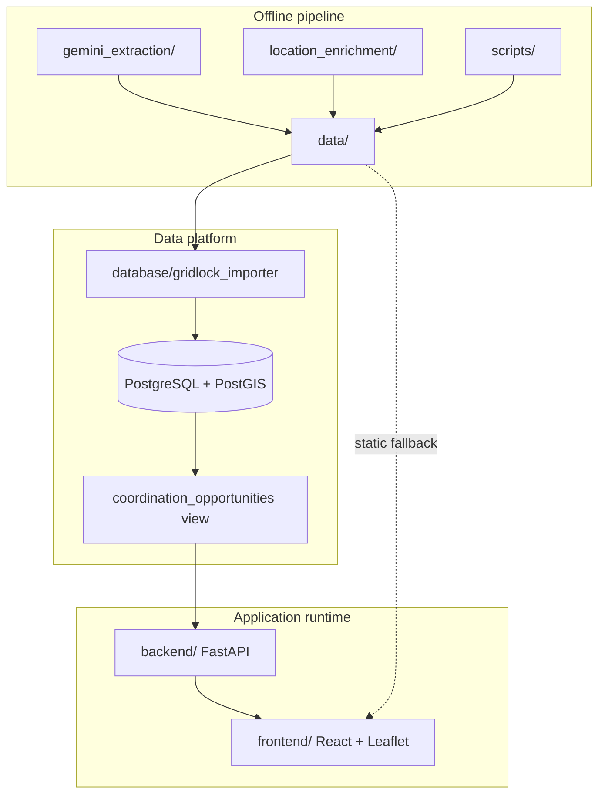

# GridLock architecture

## Decision

Organize the repository by runtime boundary while retaining one repository for the hackathon project:

- `frontend/` owns browser code and offline UI snapshots.
- `backend/` owns HTTP routes, response models, database reads, and recommendation formatting.
- `database/` owns migrations and the validated JSON importer.
- `data/`, extraction, enrichment, and scripts remain separate from runtime code because they are offline data-pipeline tools.

## Boundaries

## Contract ownership

The versioned project payload in [context.md](../context.md) is the shared contract. Database column names are internal. The API returns the versioned payload and opportunity envelope; the frontend consumes those responses without recreating distance or timeline analysis.

## Consequences

- Frontend dependencies and build commands run from `frontend/`.
- Backend starts with `python -m uvicorn backend.main:app` from the repository root.
- Offline scripts keep their existing repository-root data paths.
- The refactor does not change database migrations, API endpoints, payloads, or dependency versions.
